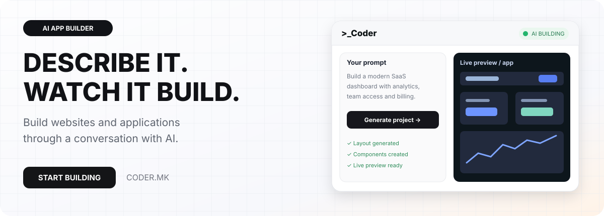

# Coder

[Македонски](README.mk.md) · [English](README.md) · [Shqip](README.sq.md) · [Türkçe](README.tr.md)

**Nga biseda te produkti digjital funksional.**

**LIVE**

## Ndërtoni me AI

**[Coder.mk](https://coder.mk)** është platformë AI e **[PROCESS IN](https://processin.mk)** për faqe dhe aplikacione. Përshkruani çfarë doni, përmirësoni përmes bisedës, kontrolloni rezultatin dhe vazhdoni në hapësirën e lidhur të ndërtimit.

Fokusi është kthimi i ideve në përvoja digjitale të redaktueshme, me zhvillim AI, reagim vizual dhe mjete nga promti te projekti.

## Një hapësirë nga ideja te publikimi

| Mundësia | Përdorimi |
|---|---|
| **Zhvillimi përmes bisedës** | Përshkruani faqen ose aplikacionin në gjuhë natyrore dhe përmirësoni kërkesat gjatë ndërtimit. |
| **Parapamja në kohë reale** | Shikoni ndryshimet pa kaluar vazhdimisht mes mjeteve të shkëputura. |
| **Redaktori i integruar** | Redaktoni skedarët me theksim sintakse dhe rrjedha zhvillimi. |
| **Shabllonet** | Nisni nga bazë dhe përshtatni paraqitjen, përmbajtjen dhe sjelljen. |
| **Sistemet e dizajnit** | Rregulloni komponentët, tipografinë, ngjyrat dhe tokenët e dizajnit. |
| **Eksporti dhe publikimi** | Përdorni rrugët e mbështetura sipas llojit të projektit dhe planit. |
| **Nëndomenet** | Publikoni dhe ndani sipas konfigurimeve të mbështetura. |
| **Bazat e të dhënave dhe API** | Lidhni projektet me baza, shërbime dhe API të mbështetura. |
| **Tema tregtie** | Rrjedha AI për tema blloqesh WordPress dhe Shopify Online Store 2.0, ku mbështeten. |
| **Hyrja zanore** | Jepni promte me zë në shfletues dhe konfigurime të mbështetura. |

## Rrjedha praktike dhe zbulimi

**Përshkruani → Gjeneroni → Shikoni → Përmirësoni → Eksportoni / Publikoni**

Rrjedha lidh promtin në gjuhë natyrore me projektin, parapamjen, përmirësimin, redaktimin e kodit dhe publikimin e mbështetur. Fushat përfshijnë faqe AI, prototipe aplikacionesh, shabllone, sisteme dizajni, tema WordPress e Shopify dhe lidhje bazash ose API.

Platforma është për themelues, agjenci, zhvillues, dizajnerë dhe biznese të vogla që shqyrtojnë ndërtues AI, promt-në-kod, gjenerim aplikacionesh, parapamje dhe redaktorë vizualë. Opsionet varen nga konfigurimi aktiv.

### Ideja juaj e ardhshme meriton të ekzistojë.

[Ndërtoni me Coder](https://coder.mk)

## Informacion për produktin

| Hollësia | Vlera |
|---|---|
| Produkti | Coder |
| Faqja zyrtare | [coder.mk](https://coder.mk) |
| Kategoria | Ndërtim faqesh dhe aplikacionesh me AI |
| Statusi | LIVE |
| Zhvilluesi | [PROCESS IN](https://processin.mk) |
| Portofoli | [PROCESS IN](https://github.com/stambolce/process-in) |

### [Vizitoni Coder](https://coder.mk)

Prezantim publik, jo kod i aplikacionit privat. Nuk publikohen të dhëna përdoruesish ose kërkime private dhe nuk jepet licencë me burim të hapur. Disponueshmëria varet nga konfigurimi dhe kushtet aktuale.

---

This platform is a digital product of <a href="https://processin.mk" target="_blank" >PROCESS IN </a>· Your Enterprise Software & AI Partner ·  Hosted on Enterprise Infrastructure by <a href="https://inhost.mk" target="_blank">INHOST</a>·
